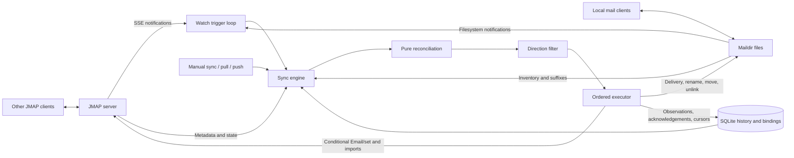
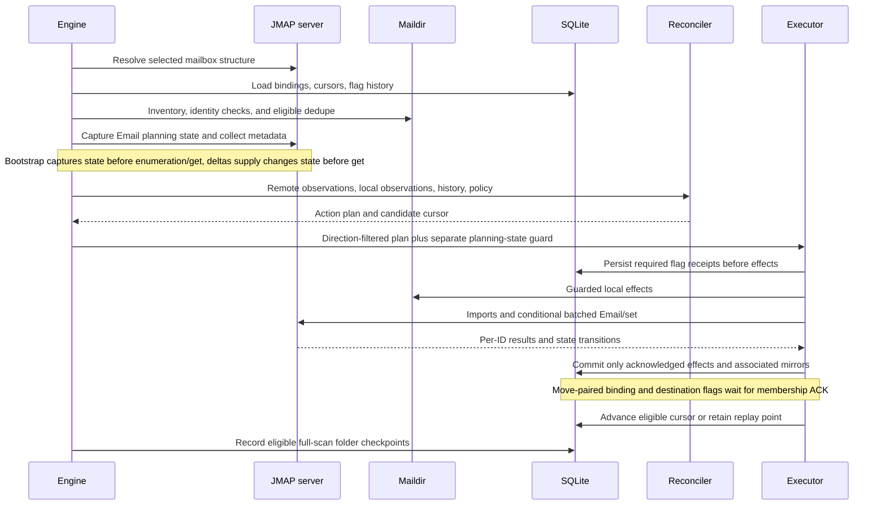
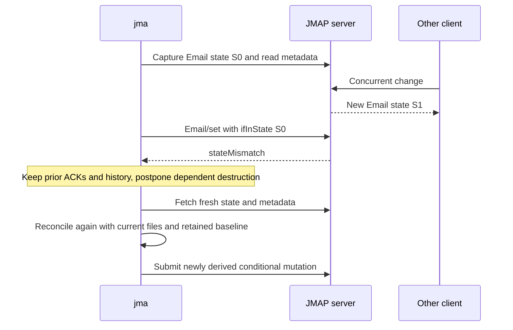
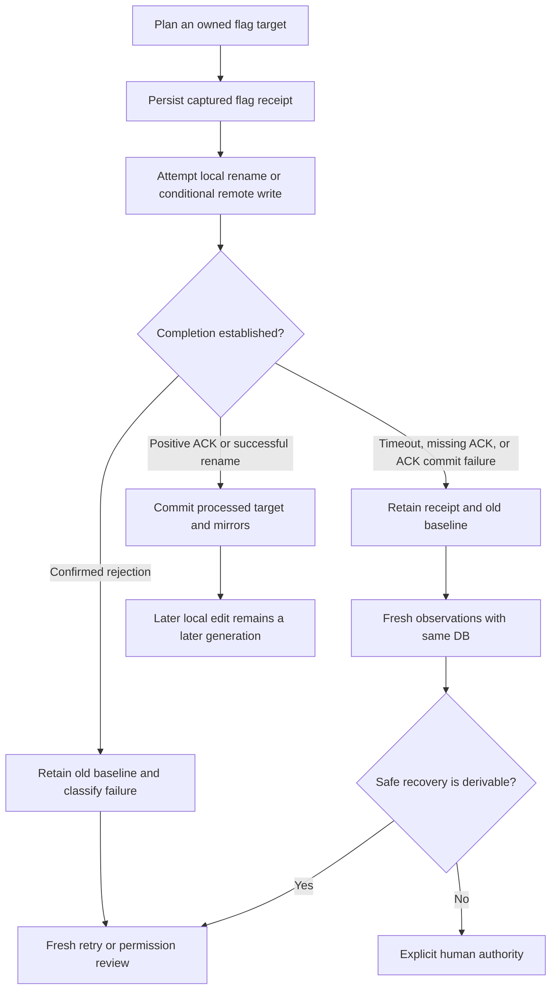
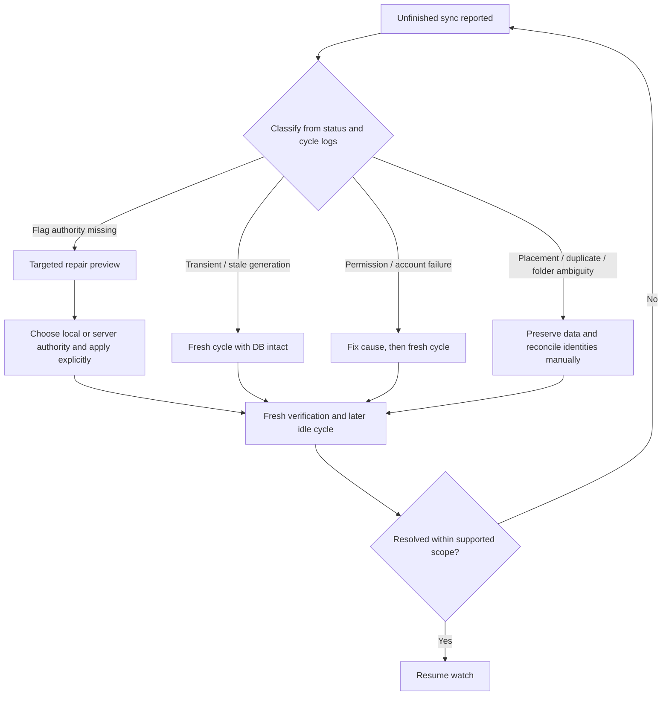

# Two-way JMAP synchronization design

[DEVELOPMENT.md](DEVELOPMENT.md) is the
implementation-level tour; [README.md](README.md) documents configuration and CLI
usage. Additional validation and hardening suggestions are explicitly labelled.
For a concrete introduction, start with the
[worked examples](#2-worked-examples-one-complication-at-a-time).

## 1. User contract and consistency model

A user should be able to read, flag, move, add, or delete supported messages in a
local Maildir or through another JMAP client, then reconcile the two sides without
unnecessarily recreating server messages. Changes made while disconnected are
compared with retained history on the next cycle.

The model is **eventual reconciliation**, not a distributed transaction, CRDT,
or last-write-wins timestamp scheme. A one-sided flag edit normally propagates
regardless of the configured conflict preference. When both sides have changed,
`conflict_strategy = "server-wins"` (the default) or `"local-wins"` selects the
whole mapped flag set. Some ambiguities cannot safely be decided from current
values and must remain unfinished for human review.

Convergence requires successful future cycles, usable identities, adequate
permissions, and sufficiently stable writers. There is no finite convergence
promise under continuous competing edits, lost history, or permanent failures.
A successful command invocation alone is not proof that every message converged.

Scope and boundaries:

- Bodies are downloaded or imported; this is not an in-place message-body merge
  engine. Do not expect edits to the contents of an already bound file to be
  propagated as revisions of the same JMAP Email.
- Flags have a six-bit portable projection. Arbitrary server keywords are
  preserved remotely but are not a portable local tagging interface.
- Each server Email has one local binding. General JMAP multi-mailbox/label-set
  synchronization is not faithfully represented; see the membership warning below.
- Retained flag history supports restart recovery with the same DB. It is not a
  durable operation/payload queue for every import, deletion, or mailbox RPC.

## 2. Worked examples: one complication at a time

Start here for concrete behavior; the later sections explain the machinery.
Each example is independent: **do not carry an earlier example's edit or failure
into the next one**. E01 has no complication. Every later example isolates one
change, conflict, unsupported input, or failure. A conflict necessarily describes
both opposing edits, but does not add an unrelated outage, move, or duplicate.
Alternative policies below are alternative runs, not successive steps.

Case families:

- [Normal synchronization and flags](#a-normal-synchronization-and-flags)
- [Message placement and deletion](#b-message-placement-and-deletion)
- [Folder creation, renaming, and deletion](#c-folder-creation-renaming-and-deletion)
- [Identity, inventory, and unsupported inputs](#d-identity-inventory-and-unsupported-inputs)
- [Races, failures, and retained work](#e-races-failures-and-retained-work)
- [History, command modes, and observation limits](#f-history-command-modes-and-observation-limits)

**Reading the examples:** local means the Maildir; server means JMAP. `A` is one
message, normally already bound to server Email `E1` in `INBOX` on both sides.
`B` is the remembered last successfully synchronized flag set. `S` means read,
`F` means starred, and `R` means replied; `FS` means read and starred. An empty
flag set means an existing message with no mapped flags, not a missing message.
Unless stated otherwise, both copies initially have `S`, `B = S`, bodies and
identities are unchanged, folders are selected and unambiguous, and an ordinary
bidirectional sync succeeds. New local messages are eligible `cur/` files with
valid Message-IDs. Folder-name examples use an ordinary flat layout without
rename rules. No unmentioned changes or failures are assumed.

### A. Normal synchronization and flags

#### E01. Already synchronized — no complication

**Before:** Local has A in INBOX with `S`; server has the same bound A in INBOX
with `S`; `B = S`.

**Handling / after:** Nothing needs changing. Local and server still have A with
`S`, and the acknowledged baseline remains `S`. There is no conflict or recovery
step.

#### E02. A message arrives on the server

**Before:** Local has no A; server has a new A with `S`.

**Handling / after:** jma downloads A and records its binding. Local and server
now both have A with `S`; the server's existing Email ID is retained. No import
or duplicate server message is needed.

#### E03. A message is added locally

**Before:** Local has a new, unbound A in `cur/` with `S`; server has no A.

**Handling / after:** jma imports A and records the returned Email ID. Local and
server now both have A with `S`. This is sending a message to storage, not sending
mail to its recipients.

#### E04. The files exist, but their binding is missing

**Before:** Local has one unambiguous A with `S`; server already has A with `S`;
this fresh setup has no binding between them. Their usable Message-ID matches.

**Handling / after:** Supported adoption binds the existing local file to the
existing server Email. Local and server still each have one A, with no body
transfer needed. The Message-ID match is a correlation hint, not proof of equal
bytes or recovery of earlier edits.

#### E05. A local user adds a star

**Before:** Local A is now `FS`; server A is still `S`; `B = S`.

**Handling / after:** Only local flags changed, so jma pushes the star. Local and
server become `FS`, and `B = FS`. Even `server-wins` permits this local-only edit;
it is not a conflict.

#### E06. A server user adds a star

**Before:** Local A is still `S`; server A is now `FS`; `B = S`.

**Handling / after:** Only server flags changed, so jma renames the local file to
carry `FS`. Local and server become `FS`, and `B = FS`. Even `local-wins` permits
this server-only edit.

#### E07. A local user removes a star

**Before:** Both previously had `FS`, so `B = FS`. Local A is now `S`; server A
is still `FS`.

**Handling / after:** jma removes the remote `$flagged` keyword with a null-valued
patch. Local and server become `S`, and `B = S`. Removal is an edit, not an absent
instruction to leave the star alone.

#### E08. A server user removes a star

**Before:** `B = FS`; local A is still `FS`; server A is now `S`.

**Handling / after:** jma removes `F` from the local suffix. Local and server
become `S`, and `B = S`. It does not mistake the remaining local star for a new
local addition.

#### E09. Both users make the same flag edit

**Before:** `B = S`; local A and server A have independently become `FS`.

**Handling / after:** Their current values already agree. No corrective flag
write is needed; local and server stay `FS`, and jma acknowledges `B = FS`.

#### E10. Both users make different flag edits

**Before:** `B = S`; local A is `FS`; server A is `RS`.

**Handling / after:** This is one competing-flags conflict. With `server-wins`,
local and server finish at `RS`; with `local-wins`, both finish at `FS`. The
baseline follows the successfully applied winner. Neither policy silently merges
the sets into `FRS`.

#### E11. Fresh adoption starts with different flags

**Before:** In a genuine fresh setup, local A is `S`, server A is `FS`, and there
is no earlier acknowledged baseline. The unique adoption itself is supported.

**Handling / after:** Bootstrap policy chooses the target: `server-wins` makes
both `FS`; `local-wins` makes both `S`. A baseline is established only after
agreement or the required effect succeeds. This does not discover which side
was edited first before setup.

#### E12. Legacy flag history cannot explain a disagreement

**Before:** An existing legacy binding has local A at `S` and server A at `FS`,
but lacks trustworthy acknowledgement history for classifying that difference.

**Handling / after:** Where the resolver requires review, local remains `S` and
server remains `FS`; choosing a global conflict preference is not a substitute
for the missing history. For eligible targets, first preview with
`jma repair-flags --authority local E1`; adding `--apply` explicitly makes both
`S`. Alternatively, choosing `--authority server` and applying makes both `FS`.
Preview alone changes neither side; the two authorities are alternatives.

#### E13a. A server-only custom label changes

**Before:** Local A has `S`; server A has `$seen` and newly added `project-blue`.

**Handling / after:** jma refreshes its full server-keyword observation. Local
still has `S`, server still has `$seen` and `project-blue`, and the label is not
invented as a portable local suffix. The mapped baseline remains `S`.

#### E13b. A local flag edit must preserve a server-only label

**Before:** `B = FS`; local A has just become `S`; server A still has `$seen`,
`$flagged`, and its pre-existing `project-blue` label.

**Handling / after:** jma removes only the owned `$flagged` keyword. Local A is
`S`; server A has `$seen` and still has `project-blue`; `B = S`. The local filename
cannot describe that label, so it must not replace the full server keyword set.

#### E14. A local suffix contains an unowned extension

**Before:** Local A has raw suffix `Sx`, where `x` is a pre-existing local
extension; server A has just changed from `S` to `FS`; `B = S`.

**Handling / after:** jma changes only its owned bits. Local becomes `FSx`,
server remains `FS`, and the mapped baseline becomes `FS`. The server does not
acquire a keyword for `x`, and the local extension is not erased.

#### E15. A local user marks a message trashed without removing its file

**Before:** Local A changes from `S` to `ST`; server A is still `S`; `B = S`.

**Handling / after:** jma sets its `$deleted` keyword convention. Local A remains
an existing file with `ST`; server E1 remains an existing Email with those mapped
flags. Marking `T` is not physical deletion or an implicit move to a Trash folder.

### B. Message placement and deletion

#### E16. A local user moves a message

**Before:** Local A has moved from INBOX to Archive, still with `S`; server E1
is still in INBOX with `S`.

**Handling / after:** jma pairs the local disappearance and arrival, updates
server membership, and rebinds after its ACK. Local and server finish in Archive
with `S`, retaining E1 rather than destroying and reimporting the message.

#### E17. A server user moves a message

**Before:** Local A is still in INBOX; server E1 has moved to Archive. Flags
remain `S`.

**Handling / after:** jma moves the local file to Archive. Local and server finish
in Archive with the same server Email ID and unchanged flags.

#### E18. Both users choose different destinations

**Before:** From a common INBOX binding, local A has moved to Archive while
server E1 has moved to Trash. Both destination folders are selected.

**Handling / after:** jma does not arbitrarily counter-move either copy. Local
stays in Archive and server stays in Trash; placement is deferred and the Email
cursor is held. A person must establish the intended consistent placement;
flag-only repair cannot choose a folder.

#### E19. A local move meets an extra, unselected server membership

**Before:** Local A has moved to Archive; server E1 still belongs to INBOX and
the **unselected** Projects mailbox. Flags are unchanged.

**Handling / after:** The current move implementation replaces membership with
`{Archive}`. Local A finishes in Archive; server E1 is in Archive but loses
Projects. This is a known membership-preservation limitation, not a safe label
merge. Projects is unselected here so this is not E18's competing-destination case.

#### E20. A local user deletes a file

**Before:** The previously bound local A is genuinely absent; server E1 is
unchanged and still exists. Full presence checks find no moved copy.

**Handling / after:** jma destroys E1 after the required checks and ACK. Local
and server both lack A. Default non-destructive *folder* policy does not prevent
this ordinary *message* deletion.

#### E21. A server user destroys an Email

**Before:** Local A still exists; server E1 has been destroyed. There are no
other edits.

**Handling / after:** jma deletes the bound local file and clears its binding.
Local and server both lack A. There is no automatic archive copy created first.

#### E22. Local deletion conflicts with a server update

**Before:** Local A is absent; server E1 has changed from `S` to `FS` since the
common baseline.

**Handling / after:** With `server-wins`, jma downloads a replacement local file,
so local and server both have A with `FS`. With `local-wins`, it destroys E1, so
both sides lack A. These are alternative outcomes of the same delete/update
conflict, not a retry followed by a second deletion.

#### E23. Server destruction conflicts with a local flag edit

**Before:** Local A has changed from `S` to `FS`; server E1 has been destroyed.

**Handling / after:** Normal remote-destroy handling removes the bound local
file, leaving neither side with A. `local-wins` does not generally resurrect an
Email already destroyed remotely. This asymmetry is why E22 cannot simply be
read backwards.

### C. Folder creation, renaming, and deletion

#### E24. A local user creates an empty folder

**Before:** Local has a new valid, unbound `Receipts/{cur,new,tmp}` Maildir;
server has no Receipts mailbox.

**Handling / after:** jma creates the remote mailbox. Local keeps its empty
Receipts folder; server now has an empty Receipts mailbox. The returned server
folder is bound through subsequent mailbox resolution; there is no message upload
in this example.

#### E25. A server user creates an empty folder

**Before:** Local has no Receipts folder; server has a new selected, empty
Receipts mailbox.

**Handling / after:** jma creates the local Maildir and its mapping sentinel.
Local and server now both have empty Receipts folders.

#### E26. A local user renames a tracked folder

**Before:** Local has renamed Archive to Saved, carrying its mapping sentinel;
server still calls that same mailbox Archive.

**Handling / after:** For this directly representable name, jma pushes a mailbox
rename. Local and server finish at Saved with the same mailbox identity. Messages
are not reimported merely because the folder name changed.

#### E27. A server user renames a tracked folder

**Before:** Local still calls the folder Archive; server has renamed that mailbox
to Saved.

**Handling / after:** jma renames the local directory and refreshes its mapping.
Local and server finish at Saved with the same server mailbox identity.

#### E28. Both users rename the same folder differently

**Before:** The cached common name was Archive. Local, with its sentinel intact,
is now LocalSaved; server calls the same mailbox ServerSaved.

**Handling / after:** `server-wins` makes both names ServerSaved; `local-wins`
makes both names LocalSaved. Unlike competing message destinations in E18, this
representable folder-name conflict has a policy winner. No parent ambiguity,
rename rule, or target collision is added to this example.

#### E29. A local folder is deleted under the default folder policy

**Before:** Local's tracked, empty Archive Maildir is gone; server's empty
Archive mailbox remains; `allow_destructive_folder_sync = "none"`.

**Handling / after:** jma does not destroy the server mailbox. The local absence
is reported as folder drift, while server Archive remains. Selecting a preferred
flag-conflict winner does not itself authorize remote folder destruction.

#### E30. A server folder is deleted under the default folder policy

**Before:** Server Archive and its sole Email A have been deleted; local Archive
still contains its previously synchronized A; folder policy is `none`.

**Handling / after:** Current non-destructive local-orphan handling recreates
Archive server-side and uploads the cataloged local content. Local keeps A in
Archive; server has Archive and A again, potentially with new IDs. Default folder
behavior is therefore not simply symmetric deletion suppression or lossless ID
restoration.

#### E31. Server folder deletion is explicitly allowed to delete locally

**Before:** Server Archive and its sole Email A are gone; local Archive still
contains its unchanged, tracked A. Policy is `delete-local`; there is no pending
local work.

**Handling / after:** Eligible local folder removal deletes Archive and its
mapped A. Local and server then both lack that folder and message. Even
`local-wins` does not invent a concurrent edit to defeat an authorized,
uncontested folder deletion.

#### E32. Local folder deletion is explicitly allowed to delete remotely

**Before:** Local's empty Archive is gone; server's empty Archive remains.
Policy is `delete-remote`; there is no new server activity.

**Handling / after:** jma destroys the remote mailbox. Local and server both lack
Archive. The destructive permission is explicit; it is not implied by `push` or
by `local-wins` alone.

#### E33. Server folder deletion conflicts with newly added local mail

**Before:** Server Archive is gone; local Archive contains a newly added,
unbound A already included in the inventory. Policy allows `delete-local`.

**Handling / after:** With `local-wins`, jma can recreate remote Archive and
upload A, preserving local Archive. With `server-wins`, it drops the upload and
removes local Archive; guarded removal rescues this *unmapped* A to a rescue
Maildir, while server Archive stays absent. Rescue is not a promise to save every
mapped message during destructive cleanup.

#### E34. Local folder deletion conflicts with newly arrived server mail

**Before:** Local Archive is gone; server Archive has just received A, its sole
Email. Policy allows `delete-remote`.

**Handling / after:** With `server-wins`, jma recreates local Archive and downloads
A, so both sides retain the folder and mail. With `local-wins`, the allowed remote
folder destruction removes Archive and its remaining sole-folder mail; local
Archive stays absent. No local message edit is added to this conflict.

### D. Identity, inventory, and unsupported inputs

#### E35. An empty Maildir peer directory is missing

**Before:** Local has A in `cur/` but its empty `new/` directory is missing;
server still has A with `S`.

**Handling / after:** Ordinary sync treats the live `cur/` inventory as present,
not as deletion of A or the whole mailbox. Local and server keep A with `S`;
merely reading the folder need not recreate `new/`. Targeted flag repair has a
stricter complete-Maildir preflight and is not being invoked here.

#### E36. A directory is unreadable, not empty

**Before:** Local A exists but jma cannot read its `cur/` directory; server A
still exists unchanged.

**Handling / after:** Authoritative inventory fails closed. Local A is not
classified as absent and server E1 is not destroyed on that supposed evidence.
Fix access and run a fresh cycle; inability to inspect a directory is not a user
delete command.

#### E37. A new local message lacks a usable Message-ID

**Before:** Local has an unbound file without a parseable Message-ID; server has
no corresponding Email.

**Handling / after:** jma logs the identity-policy problem and skips the file.
Local bytes remain; server gets no import. No synthetic identity or durable
headerless-ingestion job is created.

#### E38. A new server message lacks a usable Message-ID

**Before:** Local has no A; an unbound server Email A has no usable `messageId`
in its metadata.

**Handling / after:** jma skips this new ingestion. Local still lacks A and
server retains it; the cursor may advance without queuing a future download.
This is different from an already-bound Email whose stable JMAP ID is known.

#### E39. A previously unknown file is only in new/

**Before:** Local has a new untracked A in `new/`, with a valid Message-ID;
server has no A.

**Handling / after:** jma does not implicitly import an unknown new-side file.
Local keeps A in `new/`; server still lacks it. E03 deliberately used an eligible
`cur/` file instead; tracked new-side messages have different flag/move handling.

#### E40. A new local message exceeds the upload limit

**Before:** Local has a valid, unbound A in `cur/`, larger than the effective
upload-size cap; server has no A.

**Handling / after:** jma refuses the oversized upload at planning time. Local A
remains; server still has no A. Retrying unchanged input is not a mechanism for
bypassing the cap.

#### E41. A server rejects an imported body as invalid

**Before:** Local has an eligible unbound A; server has no A and rejects its
import with the confirmed per-message `invalidEmail` error.

**Handling / after:** jma preserves local A and does not record a successful
upload or server binding. Server still lacks A. The file may be reassessed in a
later full cycle, but there is no general durable body-repair/payload queue.

#### E42. There is an extra byte-identical local copy

**Before:** Local has a tracked A and a younger, untracked byte-identical copy in
the same folder; server has just its existing E1 for A.

**Handling / after:** An eligible full dedupe pass can remove the younger,
untracked duplicate after content verification, preserving the live tracked
anchor. Local and server then each have their original A. A matching header
alone would not have authorized this deletion.

#### E43. The matching Message-ID hides different bodies

**Before:** Local has tracked A plus an untracked content-distinct file A2 with
the same Message-ID; server has the bound E1 for A.

**Handling / after:** Content-safe dedupe preserves both local files, and A2 is
not allowed to replace the live A binding. Server E1 remains A. Review the extra
variant rather than treating one header as proof that A2 is disposable or that
its flags should overwrite A's history.

#### E44. A local user edits an already-bound message body

**Before:** Local A's body has been edited in place; server E1 still has the old
body. File identity and flags remain unchanged.

**Handling / after:** This is outside the body-sync contract: jma does not merge
or upload that edit as a revision of E1. Local keeps the edited bytes; server
keeps the old bytes. Equal flags do not mean these body versions were reconciled.

### E. Races, failures, and retained work

#### E45. The local suffix changes after a pull is planned

**Before:** A pull captured local suffix `S` and server target `FS`. Before the
rename, the MUA changes local A to `RS`; server is still `FS`.

**Handling / after:** Snapshot validation refuses to overwrite the changed
suffix with the stale plan. Local stays `RS`, server stays `FS`, and the old
baseline is not acknowledged as a completed pull. Fresh reconciliation must
consider the current values before choosing a new target.

#### E46. The server changes after a push is planned

**Before:** A push captured local `FS`, server `S`, and Email state S0. Before
Email/set, another server client changes A to `RS`, advancing the state.

**Handling / after:** `ifInState = S0` is rejected. Local remains `FS` and server
remains `RS` at rejection. jma replans from fresh observations, then the ordinary
whole-set conflict policy can make both `RS` or both `FS`; it does not attach a
new cookie to the old payload and blindly resend it.

#### E47. A flag push is temporarily rejected

**Before:** Local A is `FS`, server A is `S`, and a conditional flag push gets a
confirmed retryable per-ID rejection.

**Handling / after:** Local stays `FS`, server stays `S`, and `B` stays `S`.
Retained work remains unfinished. In watch mode, its retry deadline drives a
fresh cycle even if nothing else happens. Once the temporary rejection stops,
a successful retry makes both `FS`; no unrelated new edit is required.

#### E48. A flag push is denied permanently

**Before:** Local A is `FS`; server A is `S`; the server rejects the push because
the account lacks permission.

**Handling / after:** Local stays `FS`, server stays `S`, and the old baseline
remains. jma reports blocked work instead of spinning on permission-only retries.
A person must fix permission or explicitly reassess authority, then verify a fresh
attempt; a successful process exit must not be read as proof of agreement.

#### E49. A flag push applies, but its reply is lost

**Before:** A push of local `FS` actually changes server A to `FS`, but jma does
not receive its ACK. The DB still has `B = S` and the retained attempt.

**Handling / after:** jma does not immediately claim success from the missing
reply. A later fresh observation finds local and server both `FS` and can
acknowledge agreement. No body reimport is needed, and this example adds no newer
MUA edit or second fault.

#### E50. A local flag rename fails

**Before:** Local A is `S`; server A is `FS`; the planned local rename fails.

**Handling / after:** Local stays `S`, server stays `FS`, and `B` remains `S`.
The failed effect is not acknowledged; retained history and cursor handling keep
it available to retry. After the cause is fixed, a fresh successful pull makes
both `FS`; server agreement with the target alone did not prove a local rename.

#### E51. Only one message in a batch is acknowledged

**Before:** For this example there are two bound messages, A and C. Local has
`FS` on each; server has `S` on each; both baselines are `S`.

**Handling / after:** The server ACKs A but rejects C. Local remains `FS` on both;
server becomes `FS` only on A and stays `S` on C. jma advances A's baseline to
`FS` but leaves C's at `S` and reports C unfinished. A batch is not an atomic
all-message commit or rollback.

#### E52. An MUA makes a newer edit while a push is in flight

**Before:** An ordinary push captured local target `FS`. During that request the
MUA changes local A back to `S`; the server successfully applies and ACKs `FS`.

**Handling / after:** Local is `S`, server is `FS`, and jma acknowledges the
*processed* target as `B = FS`, not the newer local suffix. The next successful
cycle recognizes the local unflag and makes both `S`. No reply loss or crash is
added to this race.

#### E53. A retained pull cannot be distinguished from a human edit

**Before:** A retained, unacknowledged pull records source `S` and target `FS`.
Current local A is `FS`, current server A is `S`, and the last acknowledged
baseline is `S`. The uncertainty is whether local `FS` is jma's own old effect
rather than new human intent.

**Handling / after:** jma defers the unsafe repush: local stays `FS`, server stays
`S`, and review is retained. For an eligible target, explicit local authority can
make both `FS`; explicit server authority can make both `S`. Current values alone
cannot supply that missing authority.

#### E54. The process stops after saving a receipt but before the push

**Before:** Local A is `FS`; server A is `S`; `B = S`. The pending attempt is in
the intact DB when the process stops, before the remote effect is sent.

**Handling / after:** Restart with the same DB gathers fresh state and can
rederive the push. After its successful ACK, local and server are `FS` and
`B = FS`. Restart did not require deleting the DB or replaying an arbitrary saved
body payload.

### F. History, command modes, and observation limits

#### E55. The acknowledgement history is lost in a DB rebuild

**Before:** Local A is `S`; server A is `FS`; the old DB history is gone. The
same visible values could mean a local unflag from a previous common `FS`, or a
server flag from a previous common `S`.

**Handling / after:** Fresh supported adoption can apply bootstrap policy:
`server-wins` makes both `FS`, or `local-wins` makes both `S`. Neither outcome
proves the lost intent was preserved. Restore a consistent backup when appropriate,
or review the fresh reconciliation explicitly; do not call this E54's same-DB
restart recovery.

#### E56. Only the server delta cursor has expired

**Before:** Local and server both still have A with `S`, and the DB retains its
binding and `B = S`; Email/changes refuses the old cursor.

**Handling / after:** jma falls back to enumeration while retaining the DB
knowledge. Local and server stay at `S`; existing bindings/history can still be
used. An expired cursor does not require erasing all acknowledgement history.

#### E57. Pull-only excludes a necessary push

**Before:** Local A is `FS`, server A is `S`, and `B = S`; the user runs `pull`.

**Handling / after:** Resolution would require a push, which this direction
filter excludes. Local stays `FS`, server stays `S`, and `B` stays `S`; jma must
not acknowledge the excluded write. Use a mode permitting the intended push to
finish it, rather than interpreting `pull` as forced server authority.

#### E58. Push-only excludes a necessary pull

**Before:** Local A is `S`, server A is `FS`, and `B = S`; the user runs `push`.

**Handling / after:** Resolution would require a local pull, which is excluded.
Local stays `S`, server stays `FS`, and `B` stays `S`. Use an appropriate mode for
the pending pull; `push` is not forced local authority.

#### E59. The user requests a dry-run

**Before:** Local A is `FS`, server A is `S`, `B = S`, and the existing DB schema
is compatible; the user runs `sync --dry-run`.

**Handling / after:** The preview can show the required push, but does not perform
or acknowledge it. Local stays `FS`, server stays `S`, and `B` stays `S`. No
schema mismatch is added here; the earlier setup warning about DB recreation is
a separate issue, not a second fault hidden in this example.

#### E60. A repair's captured preview becomes stale

**Before:** Within one apply attempt, the repair preview captured local `S` and
server `FS`. Before that apply's final validation, an MUA changes local A to `RS`.

**Handling / after:** Apply refuses the stale snapshot rather than asserting its
old authority over unseen input. Local stays `RS`, server stays `FS`; inspect
again before explicitly retrying. A separate preview CLI invocation is not a
saved transaction token: the later apply invocation performs fresh inspection.

#### E61. Only the source half of a move notification is delivered

**Before:** Local A is already in Archive and server E1 is still in INBOX, but
the watcher received only the old INBOX path event. Flags are unchanged.

**Handling / after:** Identity/deletion preflight widens to full inventory rather
than treating that single event as proof of deletion. With the unique cur-side
destination found, normal move handling can put both sides in Archive while
preserving E1. There is no simultaneous flag conflict or request failure.

#### E62. Self-write suppression hides an immediate local deletion

**Before:** jma just delivered local A; server A exists. The user deletes that
file within the suppression TTL and the deletion event is swallowed.

**Handling / after:** Until another full cycle, local lacks A while server still
has it. A later full inventory detects the deletion and can remove the remote
Email after normal checks. This is delayed propagation, not a promise that every
filesystem event wakes a cycle; the next full cycle is not guaranteed immediate.

#### E63. Cached status has not seen a server edit

**Before:** Local A and cached observations have `S`, with no pending cached
history; server A has independently changed to `FS` since the last sync.

**Handling / after:** `status` performs no remote verification. Local stays `S`
and server stays `FS`, even if cached counts are zero and the cursor is labelled
healthy. A fresh sync, not the status display, can observe the edit and make both
`FS`.

#### E64. Another cooperating jma mutator already holds the lock

**Before:** Local and server A agree at `S`; one jma process holds the Maildir
lock, and a second invocation tries to mutate the same Maildir.

**Handling / after:** The second invocation fails to acquire the lock and makes
no message changes; the first may continue. In this otherwise unchanged example,
local and server remain `S`. This lock does not forbid an MUA or a remote client
from editing; those races are handled separately above.

## 3. Architecture and ownership



| Responsibility | Implementation |
| --- | --- |
| Gather observations, resolve folders, widen scans, replan generations | [sync/engine.rs](src/sync/engine.rs) |
| Describe actions and retain/filter them by direction | [sync/plan.rs](src/sync/plan.rs) |
| Choose actions without doing filesystem or network I/O | [sync/reconcile.rs](src/sync/reconcile.rs), [flag_resolution.rs](src/sync/flag_resolution.rs) |
| Order effects and commit their corresponding state | [sync/execute.rs](src/sync/execute.rs) |
| Encode JMAP mutations and classify responses | [jmap/email.rs](src/jmap/email.rs), [email_set.rs](src/jmap/email_set.rs), [retry.rs](src/jmap/retry.rs) |
| Strict inventory, guarded file operations, folder identity | [maildir_ops](src/maildir_ops) |
| Persist observations separately from acknowledged flag history | [state/queries.rs](src/state/queries.rs), [flag_sync.rs](src/state/flag_sync.rs) |
| Coalesce events and schedule retained-work retries | [daemon/runner.rs](src/daemon/runner.rs), [daemon/retry.rs](src/daemon/retry.rs) |

Filesystem events and SSE are wake-up hints, not an authoritative ordered change
log. `watch` funnels them into one cycle at a time. Initial/manual/remote and
structural triggers use full scans; ordinary known-file flag events can use
path-scoped scans. Identity transitions, deletion candidates, or retained work
can widen a path scan to full inventory.

Coalescing helps join the two notification halves of a local move. Safety does
not depend on timing alone: full-inventory escalation and execution-time presence
checks also protect against mistaking an incompletely observed move for deletion.

## 4. Identity and durable knowledge

Three namespaces must not be confused:

- **JMAP Email ID:** identity of a server object. Mailbox, blob, and thread IDs
  are separate identities; a move should preserve the Email ID.
- **Maildir ID:** filename identity of a local file, separate from its suffix
  and folder. Location and raw suffix are captured when planning an effect.
- **RFC Message-ID:** a fallible correlation hint for adoption and move pairing.
  It is neither unique nor a content digest. Identical headers can describe
  different bodies, draft versions, or multiple independent server objects.

Folder bindings live in `mailbox_map` and `.jma.mapping` sentinels. Server paths
include the parent hierarchy; a display name alone is ambiguous. Layout and
rename rules project those paths onto disk, with special handling for the inbox
role. A sentinel can identify a relocated folder without treating it as an
unrelated deletion and creation.

The SQLite model deliberately separates knowledge:

| Stored information | Meaning | Does not prove |
| --- | --- | --- |
| `local_state.flags` | Last observed raw local suffix | A corresponding remote write succeeded |
| `message_map.flags` / `jmap_keywords` | Observed server projection / full keywords | A local rename succeeded |
| `message_flag_sync.baseline` | Last acknowledged common six-flag set | That no later edit occurred |
| Optional flag attempt receipt | Captured identity, source suffix/location, target | The effect completed merely because it was attempted |
| `jmap_state` | Per-account, per-entity delta cursor | A transaction spanning server, disk, and SQLite |
| `folder_checkpoint` | Scan optimization from folder mtimes/counts | An authoritative message identity or operation journal |

A NULL baseline means unfinished/unknown synchronization, **not** the empty flag
set. Empty is a valid acknowledged flag set. Cached observations must never be
promoted into successful acknowledgements just because they were recorded.

## 5. One reconciliation cycle



New remote objects are downloaded, or adopted when an existing local file can be
safely correlated. New eligible local files are imported, or adopted rather than
uploaded again when already represented remotely. Same-Message-ID content
variants and ambiguous bindings are not permission to overwrite a live anchor.
Local dedupe verifies complete content, preserves content-distinct variants, and
vetoes deletion of DB-tracked files; it is not header-only duplicate deletion.

Execution is dependency-ordered rather than plan-list order. Observations and
ordinary adoption precede effects that need the binding. Ordinary local effects
precede the remote-set phase. A paired local move is different: remote membership
must be submitted and positively acknowledged before committing its destination
binding and any dependent destination flag rename.

`pull` and `push` filter mutation directions; they do not change conflict policy
or force an otherwise rejected winner. Adoption and history observations can
survive either filter without acknowledging an excluded mutation.

A sync dry-run does not execute planned effects or acknowledge them. However,
ordinary command setup still opens the DB and connects. In particular, an
incompatible schema can trigger DB recreation **before** dry-run planning.
Use a compatible DB and preserve backups; dry-run is not a history-preserving
substitute for targeted repair.

## 6. Conflict resolution: which side wins?

### Flags and custom metadata

Let `L` be the current local mapped flags, `R` the current remote mapped flags,
and `B` the acknowledged baseline. With verified history and no unresolved
receipt/review complication:

| Observation | Decision |
| --- | --- |
| `L = R` | Agreement; acknowledge that set |
| `L != B`, `R = B` | Local-only edit; push `L`, even under server-wins |
| `L = B`, `R != B` | Remote-only edit; pull `R`, even under local-wins |
| Both differ from `B` and from each other | Choose `R` under server-wins, `L` under local-wins |
| Genuine bootstrap disagreement with no earlier history | Use configured policy; acknowledge only after completion |
| Legacy/ambiguous disagreement or retained explicit review | Do not invent history; defer for explicit authority where required |

The winner is a **whole six-flag set**, not the union of additions. For example,
with `B = S`, `L = FS`, and `R = RS`, server-wins selects `RS`; local-wins selects
`FS`. Neither implicitly selects `FRS`. This is a deliberate policy choice, not
reconstruction of the wall-clock order of user actions.

The mapping is `D/$draft`, `F/$flagged`, `P/$forwarded`, `R/$answered`,
`S/$seen`, and `T/$deleted`. `$deleted` is a jma convention; setting `T` is not
itself an `Email/set destroy` operation.

Remote patches set owned keywords with `true` and remove them with `null`.
Omission means leave untouched; `false` is not a keyword-removal encoding.
Unowned keywords such as user labels remain unmentioned. Local renames replace
only owned suffix letters and preserve extensions. Adding Seen may promote a
file from `new/` to `cur/`; clearing Seen does not move it back to `new/`.

### Messages, placement, and folders

| Situation | Existing behavior, subject to direction and safety gates |
| --- | --- |
| Local file deleted; server unchanged | Destroy the bound remote Email after absence/presence checks |
| Local file deleted; actual remote change conflicts | Server-wins restores by download; local-wins destroys remotely |
| Remote Email destroyed; local flags edited | Normally delete the bound local file; local-wins does not resurrect every remotely destroyed Email |
| Local cross-folder move | Pair disappearance/arrival; update membership and rebind, rather than destroy/import |
| Local and remote choose competing selected destinations | Defer placement for review and hold the Email cursor |
| Local folder removed under default `none` policy | Do not destroy its server counterpart; report the local absence as drift |
| Server folder removed under default `none` policy | Preserve the surviving local folder; current orphan handling can recreate the remote mailbox and upload its cataloged content |

**Membership limitation:** local moves currently send a full `mailboxIds`
replacement containing only the destination. This can strip other memberships,
including unselected server labels. Keyword preservation does not imply mailbox
membership preservation. This limitation is explicit in
`reconcile::emit_detected_moves`; do not advertise the current projection as a
lossless multi-label sync.

Default folder behavior is asymmetric: preserving a server-deleted local orphan
can actively recreate the remote mailbox and upload its cataloged messages
(`emit_local_orphan_resurrects`), whereas a local folder deletion does not itself
authorize destroying the remote mailbox. E29 and E30 show these separately.

Destructive folder deletion has its own opt-in: `delete-local`, `delete-remote`,
or `both`. When permitted and no conflicting cycle-local work blocks it, deletion need not
consult the conflict preference. With competing local work against a server
folder deletion, server-wins can discard/reverse that work and delete locally;
local-wins can recreate the remote mailbox and reupload its snapshot. Conversely,
with competing server changes against local folder deletion, server-wins can
recreate/download locally; local-wins can counter-move and destroy remotely.
Recreation is not restoration of the old server IDs or all server-only metadata.
Unresolved flag history/presence and failed dependent counters can defer cleanup.

Default non-destructive **folder** policy does not disable ordinary **message**
deletions. Opting into destructive folder sync is not a backup strategy. Guarded
folder removal rescues unmapped local-only files, not every mapped file carrying
valuable unpushed edits.

## 7. Races, partial success, and restart recovery

### Separate local and remote concurrency controls

Cooperating jma mutators acquire the Maildir lock, then the state-DB lock, in that
order. Locks serialize cooperating processes and guard schema-rebuild unlinking;
they do not stop an MUA, remote client, or direct SQLite editor.

Local flag writes validate the exact planned raw suffix and a unique live path,
refuse conflicting targets, and perform the corresponding durability steps.
A stale plan must not search for the latest suffix and overwrite it. This is
snapshot validation, not filesystem-wide compare-and-swap against arbitrary
non-cooperating writers.

Normal reconciliation Email/set uses account-scoped **Email object state** in
`ifInState`. The guard is captured before the metadata it protects. A query-state
or session-state token is not a substitute, and a cursor target is not the guard.
The executor refuses an actual Email/set without a valid planning-state guard.



A state mismatch is a generation rejection, not permission to resend the same
payload with a freshly fetched cookie. The engine permits at most three generation
attempts per run, preserving direction filters and prior completed effects.
Exhaustion stays visibly unfinished. Explicit per-ID failures retain their normal
backoff/permission treatment rather than being hammered by this immediate loop.

Each batch chunk requires its own guard and positive per-ID ACKs. Earlier
successful chunks remain committed if a later chunk fails. Own import/set state
transitions can advance the guard/cursor only along a verified contiguous
`oldState -> newState` chain. Missing continuation state or unrelated intervening
writes require fresh reconciliation, never an unguarded fallback.

Mailbox operations, imports, local effects, and Email/set are not one conditional
transaction. Explicit destructive maintenance also has different preflight and
uses an unconditioned Email/set path; it must not be confused with normal
reconciliation's state guard.

### Acknowledgements and ambiguity



An HTTP success without the target ID in `updated`/`destroyed` is not success for
that ID. A timeout can mean the server applied the write but the reply was lost.
Conversely, a clean method-level rejection is not evidence of an applied write;
a later rejection must not erase ambiguity from an earlier possibly applied
attempt. Confirmed permanent rejections are distinct from retryable failures.

Acknowledgement records the **processed target**, not a newer suffix an MUA may
have written during the RPC. A fresh remote match can establish an older push
under the receipt checks and leave a newer local edit available to propagate.
A matching remote target alone cannot prove that an earlier local pull rename
completed.

The especially dangerous case is a pull that renamed successfully but lost its
DB acknowledgement. If the server then changes, the old local pull target can
look like a new human edit. The resolver defers unsafe repushes for review rather
than pushing its own stale rename back to the server.

SQLite transactions keep associated DB mirrors coherent, but cannot roll back an
already completed remote operation or filesystem rename. Downloads publish
barrier-synced temporary files before publishing their binding in the DB. A crash
can still occur between stores. Recovery uses retained observations, bindings,
receipts, and replay—not a claim of universal exactly-once effects.

### Cursors and liveness

Failed/skipped pull effects, unfinished placement, generation rejection, and
presence-vetoed destruction can hold the Email cursor so the next cycle sees the
relevant changes again. Holding it does not undo earlier effects. Conversely,
flag history remains necessary even when no new delta arrives: the absence of a
new event is not acknowledgement of pending work.

Expired `Email/changes` history (`cannotCalculateChanges`) clears the cursor and
falls back to enumeration. This is different from deleting the whole DB: retained
bindings and flag baselines can still participate in reconciliation.

`watch` owns an event-independent retained-work deadline with exponential backoff
from 1 to 60 seconds, separate from transport reconnection. A retry takes fresh
full inventory rather than replaying serialized old actions. Path no-ops cannot
clear the deadline. Permanent rejection/review-only work does not spin on a timer;
a later ordinary/manual cycle can reassess it. The rejection mask is
daemon-lifetime state, not a general durable queue.

Self-write suppression is an optimization, not a delivery guarantee: an immediate
delete of a freshly delivered file can be swallowed during the suppression TTL.
A subsequent full cycle catches it. The design does not promise prompt
reconciliation after every missed/suppressed filesystem event or retries for all
body-import and mailbox failures.

## 8. Human attention and recovery

There is no interactive `ask` conflict strategy and no general conflict inbox or
all-purpose `resolve` command. Unattended operation must surface incomplete work
without blocking on stdin.

Read the cycle's warnings and pending/deferred/failed counts, not just its landed
operation totals. `jma status` reports cached selected flag histories as pending,
blocked/review, or unverified, plus cursor information and folder drift. It is
offline: a healthy cached cursor or zero cached flag counts does **not** verify
current remote state, all placement, or skipped ingestion. Ordinary sync can
return an outcome containing unfinished work without a command-level error;
explicit incomplete `repair-flags --apply` returns nonzero.



### Safe operating procedure

1. Stop `watch` and other cooperating mutators before repair. Pause MUA and
   remote edits when reviewing identity/placement or taking a consistent backup.
   Preserve the Maildir, sentinels, config, and DB. Use a consistent SQLite backup
   or close all connections before copying the DB, accounting for WAL state.
2. Run `jma status --config /path/to/config.toml` and preserve relevant warnings.
   Identify **JMAP Email IDs**, actual paths, current suffixes, full remote
   keywords, baseline, and any retained attempt. RFC Message-ID alone is not a
   repair target. Keep tokens and message contents out of shared diagnostic logs.
3. Classify the problem. Fix credentials, permissions, quota, disk space, or an
   unreadable inventory before retrying. A missing file, competing destination,
   duplicate identity, and unknown flag authority require different remedies.
4. For an eligible flag-only disagreement, preview explicit authority:

   ```sh
   jma repair-flags --config /path/to/config.toml --authority local EMAIL_ID
   # Alternatively choose --authority server for the fresh remote six-flag set.
   ```

   Review the preview, then explicitly apply the chosen authority:

   ```sh
   jma repair-flags --config /path/to/config.toml --authority local --apply EMAIL_ID
   ```

   Repair revalidates selection, server/account, bindings, history, exact live
   file identity, placement, sentinel, Message-ID, and blob/thread anchors.
   Missing, duplicate, moved, multiply-bound, or partial-Maildir targets are
   refused. This is deliberately stricter than ordinary partial-Maildir sync.
5. Repair changes only mapped flags. It does not import/download/destroy messages,
   dedupe, repair placement, recreate folders, or advance account cursors.
   Preview does not mutate flag observations/history; normal lock, compatible
   schema-initialization, and discovery-cache behavior still applies. Interrupted
   or partial apply retains review as needed. Re-preview and explicitly rerun;
   there is no atomic all-target transaction or durable authority job queue.
6. For placement or duplicate ambiguity, preserve both candidates first and choose
   the intended object/folder with the user. Restore a unique consistent placement
   using the MUA/server client and supported maintenance as appropriate; do not
   fabricate acknowledgements in SQLite. `repair-flags` is not a placement fix.
   `janitor prune` previews folder cleanup; non-empty/in-config force flags and
   remote destruction are separate destructive decisions, not routine retries.
7. After restoring compatible identities, inspect a fresh sync preview, run the
   intended sync, and independently compare actual files with fresh server
   metadata. Recheck cached history and cycle diagnostics, then run another cycle
   without edits to detect oscillation or retained work. Resume `watch` only when
   the result and any remaining limitations are understood.

### DB reset is not ordinary restart recovery

Normal sync/pull/push/watch opens an incompatible schema by deleting/recreating
the DB and WAL/SHM siblings, without automatic backup or confirmation. Read-only
opening refuses incompatible history; maintenance and targeted repair use the
history-preserving opening path and also refuse it. Do not mix old/new mutating
binaries against the same DB merely because both accept its schema version.

A rebuild does not itself delete Maildir messages, but the following sync is a
normal mutating reconciliation. It can adopt, upload, download, dedupe, change
flags, and propagate deletions. Adoption cannot recover erased intent.

For example, current `L = S`, `R = FS` could mean a local unflag after a common
`FS`, or a remote flag after a common `S`. Without `B`, these histories are
indistinguishable. The DB is rebuildable, **not losslessly disposable**. Restore
consistent history from backup when appropriate; otherwise treat rebuilding as
a fresh reconciliation with explicitly reviewed policy, not transparent recovery.

## 9. How races are exercised

Existing regression suites run real engine cycles against temporary Maildirs,
SQLite, and a stateful JMAP peer. The peer applies keyword patches, exposes fresh
reads, injects concurrent edits/failures, and distinguishes rejection from
ambiguous success. Tests compare independent server observations, actual filenames,
DB baselines/receipts, reopening the **same DB**, and later idle cycles—not merely
request counts or a successful return value.

| Interleaving / fault | Required observation | Existing regression location |
| --- | --- | --- |
| All owned-bit additions/removals, custom-only changes | Correct projection; no custom-keyword erasure | [keywords.rs](src/keywords.rs), [flag_tests.rs](src/sync/flag_tests.rs) |
| Remote edit between observation and Email/set; mismatch in a later chunk | Fresh replan; preserve earlier ACKs; no unguarded continuation | [generation.rs](src/sync/flag_tests/generation.rs) |
| Local edit during an applied but unacknowledged push | ACK only old target; preserve newer local intent | [flag_tests.rs](src/sync/flag_tests.rs), [generation.rs](src/sync/flag_tests/generation.rs) |
| Pull rename/ACK failure followed by remote edit and restart | Safe fresh pull or explicit review, never invented repush | [pull_ack.rs](src/sync/flag_tests/pull_ack.rs) |
| Move membership rejection, missing ACK, or destination rename failure | No false placement completion; recover at actual destination | [flag_tests.rs](src/sync/flag_tests.rs) |
| Split move notification or changed-ID candidate in new/ | Full presence checks; no premature remote/folder destruction | [flag_tests.rs](src/sync/flag_tests.rs), [maildir_cases.rs](src/sync/flag_tests/maildir_cases.rs) |
| Missing peer directory, unreadable inventory, stale suffix, target collision | Use live inventory or refuse safely; do not infer empty/deleted | [partial.rs](src/sync/flag_tests/partial.rs), [store.rs](src/maildir_ops/store.rs) |
| No follow-up event after transient failure; reconnect; busy DB | Deadline survives and drives fresh retry; review-only work does not spin | [flag_tests.rs](src/sync/flag_tests.rs), [daemon/retry.rs](src/daemon/retry.rs) |
| Stale repair preview or interrupted explicit authority | Revalidate; retain review; no unrelated sync effects | [repair.rs](src/sync/flag_tests/repair.rs), [CLI repair tests](tests/flag_repair.rs) |
| DB wipe rather than same-DB reopen | Fresh adoption/rebuild behavior, not a claim of retained intent | [e2e_state_wipe.rs](tests/e2e_state_wipe.rs) |

The real-server flag gate is [e2e_flag_sync.rs](tests/e2e_flag_sync.rs). It seeds
through IMAP independently of jma, runs real engine cycles, and checks fresh JMAP
metadata, files, identity/body stability, and later idle behavior. It is ignored
by ordinary test runs and requires the configured Stalwart fixture. Passing the
stateful peer model does not substitute for this gate; native Stalwart does not
by itself establish Docker/MySQL or hosted-provider behavior.

Useful verification commands, with platform and fixture setup from DEVELOPMENT:

```sh
cargo clippy --all-targets --locked
cargo test --locked
cargo test --locked --test e2e_flag_sync -- --ignored --nocapture --test-threads=1
```

These are verification entry points, not a claim that they were executed when
this document was written.

## 10. Remaining boundaries and suggested hardening

Current limitations must remain visible rather than being hidden by an idle
summary:

- New local files without a parseable Message-ID are skipped with an error log;
  unbound remote messages without one are also skipped and the cursor may advance.
  This is a jma identity-policy limitation, not a JMAP requirement. Unknown new/
  files are not implicitly imported. Import rejections such as `alreadyExists`
  or `invalidEmail` preserve local bytes but are not a durable payload queue.
- Message-ID adoption is not proof of byte equality. Extra variants and multiple
  live bindings require review, not arbitrary collapse.
- Whole-set flag arbitration is not a per-bit merge. Multi-mailbox membership
  replacement and folder resurrection can lose relationships or identities.
- State guards do not provide a single snapshot or transaction across Email,
  Mailbox, disk, and SQLite. Advisory locks exclude only cooperating processes.
- Cached status is not a complete live conflict report. There is no general
  machine-readable conflict queue or guaranteed nonzero exit for every incomplete
  ordinary sync outcome.

**Suggested future work, not implemented guarantees:** preserve the full mailbox
membership set when moving; make incompatible-history rebuild an explicit,
backup-aware operation; provide durable structured conflict diagnostics and
clear incomplete-run exit semantics; define a safe identity policy for headerless
messages. Additional validation should inject process termination at persistence
boundaries, real OS notification loss/reordering, concurrent non-cooperating MUAs,
and provider-specific protocol failures. Hardware power-loss durability and
arbitrary cross-writer linearizability are not established by the current
stateful regression model.
